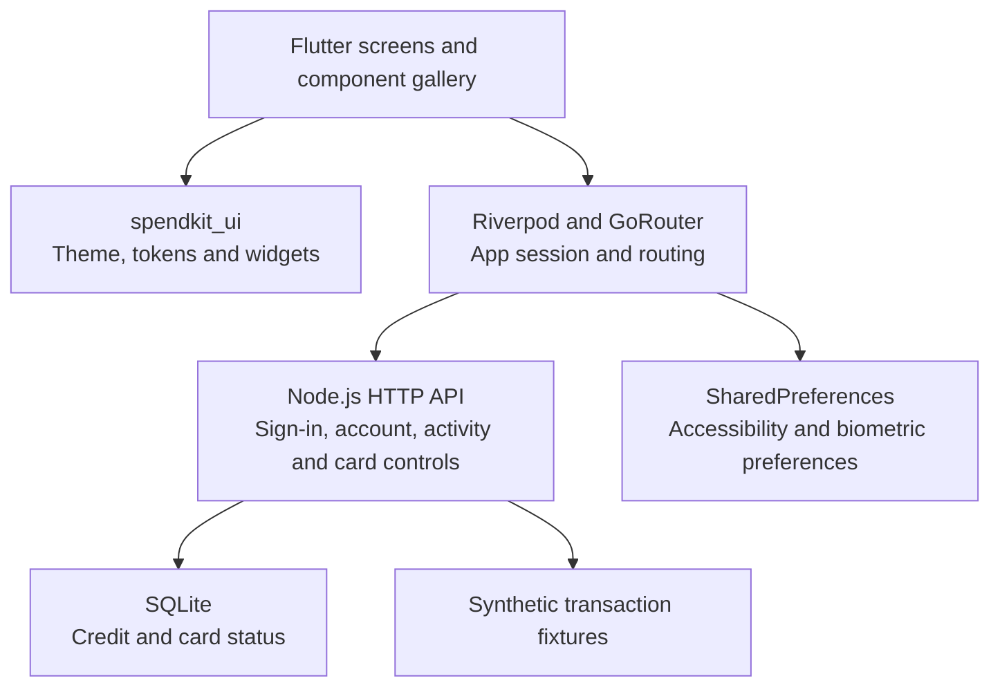

# SpendKit

**Tech stack** · Flutter and Dart · Riverpod · GoRouter · Node.js · SQLite · Material 3 and `spendkit_ui` · SharedPreferences · `local_auth` · Flutter unit, widget, and golden tests · Codemagic CI

A Flutter portfolio project for a fictional UK small-business credit account. Sign in with demo access code **2048** to review credit, filter activity, explore six months of spending, and manage a virtual card. In the Card tab you can freeze the card, set a per-transaction limit and block ATM withdrawals.

[Watch the two-minute SpendKit walkthrough](docs/spendkit-demo.mp4) · [Dashboard screenshot](docs/dashboard.png)

## Native SwiftUI version

The [SwiftUI client](swift-native/README.md) uses the same SpendKit API and SQLite card state. Open its Xcode project for iPhone or use Swift Package Manager to preview it on macOS.

## Run locally

Install Flutter **3.50.1**, the version selected by Codemagic, and **Node.js 24 LTS**. For the browser demo, install Chrome. For mobile, install the appropriate Android SDK or Xcode tooling.

From the project root, start the local API and open SpendKit in Chrome with one command.

```sh
./tool/start.sh
```

To run the native Android app, start your emulator and pass its device ID to the same script. The script generates and configures the Android runner and starts the API on your Mac. The emulator reaches it through `10.0.2.2`.

```sh
flutter emulators --launch SpendKit_Pixel
./tool/start.sh emulator-5554
```

Enable **Biometric unlock** in Settings on a supported mobile device. It can reopen a locked session while its server token is still in memory and valid. Sign in with **2048** again after restarting the app. Card changes require the access code, which the API checks independently.

## Demo the card simulator

From Home, select **Open simulator**. Run a purchase above the displayed per-transaction limit to see the decline reason. Then try a smaller purchase. From **Card → Edit spending controls**, block ATM withdrawals and verify with **2048**. Run the same amount as an ATM withdrawal and compare the outcome. Freezing the card takes precedence over the other rules. The simulator reads the card settings from the backend and leaves balances and transaction history untouched.

The dashboard includes a six-month spending chart. Select a bar to see the category breakdown for that month.

## Architecture



The API listens on loopback at port 8787. Run `node backend/server.mjs` to start it independently. SQLite creates `backend/data/spendkit.sqlite` automatically. The database holds a single fictional account and its card state and spending controls. Transactions are generated from six months of fixtures. Flutter filters that list and calculates monthly totals in integer pence.

| Method | Route | What it does |
| --- | --- | --- |
| GET | `/health` | Check API readiness |
| POST | `/session` | Exchange the demo code for a one-hour bearer token and account snapshot |
| GET | `/account` | Read the signed-in account snapshot |
| GET | `/transactions` | Read the signed-in account’s fictional transactions |
| PUT | `/card` | Apply an explicit frozen state after validating the session and access code |
| PUT | `/card/controls` | Save a per-transaction limit in pence and an ATM withdrawal setting after re-verifying the access code |
| POST | `/card/simulations` | Evaluate a fictional purchase or ATM withdrawal against the saved card policy |
| DELETE | `/session` | Revoke a bearer token |

Tokens are held in memory by the app and server. The card state survives server restarts. The demo uses a public code, one account, local HTTP and fictional card policy settings. It does not process or authorise transactions. A deployment with real data would require authenticated users, TLS and per-account authorisation.

## Consume the UI kit

Add the package to another Flutter application's `pubspec.yaml` using the appropriate relative path.

```yaml
dependencies:
  material_ui: 1.11.1
  spendkit_ui:
    path: ../SpendKit/packages/spendkit_ui
```

```dart
import 'package:material_ui/material_ui.dart';
import 'package:spendkit_ui/spendkit_ui.dart';

Widget example(VoidCallback onContinue) => MaterialApp(
  theme: SpendTheme.build(Brightness.light),
  home: Scaffold(
    body: Center(
      child: SpendButton(label: 'Continue', onPressed: onContinue),
    ),
  ),
);
```

## Tests and builds

```sh
node --test backend/server.test.mjs
flutter analyze
flutter test
(cd packages/spendkit_ui && flutter pub get && flutter analyze && flutter test)
```

App tests cover date and merchant filtering, monthly aggregation, session transitions, persistence, and the sign-in-to-freeze flow with a fake API. UI kit tests cover busy buttons, 200% text scaling, and light and dark golden images for shared panel and button geometry and colour. The fixture excludes text so the golden images are independent of installed fonts. Update the baselines after an intentional visual change.

```sh
cd packages/spendkit_ui
flutter test --update-goldens
```

[Codemagic configuration](codemagic.yaml) generates runners, analyzes and tests both packages, and builds an Android debug APK and an unsigned iOS app. Connect the GitHub repository in Codemagic to run the SpendKit workflow on pushes to main and pull requests targeting main. [Codemagic Flutter build documentation](https://docs.codemagic.io/yaml-quick-start/building-a-flutter-app/)

The recorded walkthrough shows the original local-storage version. The current backend keeps card status in SQLite. See the [two-minute recording script](docs/demo.md) for the portfolio walkthrough.
