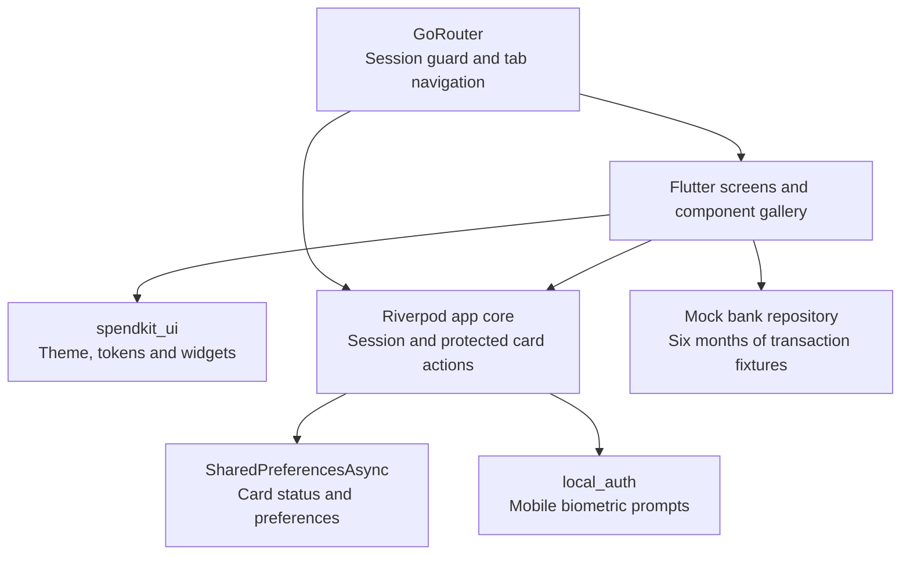

# SpendKit

**Tech stack** · Flutter and Dart · Riverpod · GoRouter · Material 3 and `spendkit_ui` · SharedPreferences · `local_auth` · Flutter unit, widget, and golden tests · Codemagic CI

A Flutter portfolio project for a fictional UK small-business credit account. Sign in with demo access code **2048** to review credit, filter activity, explore six months of spending, and manage a virtual card.

[Watch the two-minute SpendKit walkthrough](docs/spendkit-demo.mp4) · [Dashboard screenshot](docs/dashboard.png)

## Run locally

Use Flutter **3.50.1**, the version selected by Codemagic. For the browser demo, install Chrome. For mobile, install the appropriate Android SDK or Xcode tooling.

From the project root, run this command to resolve dependencies and open the app in Chrome. No backend setup is required.

```sh
./tool/start.sh
```

Generate the Android and iOS runners before running on a phone or simulator. The setup script applies Android biometric activity and theme configuration and the iOS Face ID usage description.

```sh
./tool/setup-mobile.sh
flutter devices
flutter run -d <device-id>
```

Enable **Biometric unlock** in Settings on a mobile device with enrolled biometrics. Use **Lock workspace** to try unlocking. The browser uses the demo access code. Both freezing and unfreezing require verification, with the access code available if biometric verification is cancelled or unavailable.

## Architecture



- **App core** owns session state and protected operations. Locking invalidates a pending verification. A card update checks the current session before writing, prevents overlapping writes, and changes the visible status after persistence succeeds.
- **Mock data** uses integer pence and a clock that tests can control. Balances and transactions are fixtures. Date filters include both endpoints, and analytics group spending by month and year.
- **Design system** is a local package with Flutter and the standalone Material UI package as its runtime dependencies. Screens share typography, spacing, theme, fields, panels, notices, and primary buttons. Open **Settings → Component gallery** to inspect the package in the active theme.
- **Accessibility** includes semantic headings, live status messages, labelled loading indicators, tooltip-labelled controls, layouts that respect system text scaling, and a persistent high-contrast preference.

The sign-in code is public and the session is in memory. Local storage holds demo settings and card status. A production deployment would require server-side identity verification and card-control enforcement.

## Consume the UI kit

Add the package to another Flutter application's `pubspec.yaml` using the appropriate relative path.

```yaml
dependencies:
  material_ui: 1.11.1
  spendkit_ui:
    path: ../SpendKit/packages/spendkit_ui
```

```dart
import 'package:material_ui/material_ui.dart';
import 'package:spendkit_ui/spendkit_ui.dart';

Widget example(VoidCallback onContinue) => MaterialApp(
  theme: SpendTheme.build(Brightness.light),
  home: Scaffold(
    body: Center(
      child: SpendButton(label: 'Continue', onPressed: onContinue),
    ),
  ),
);
```

## Tests and builds

```sh
flutter analyze
flutter test
(cd packages/spendkit_ui && flutter pub get && flutter analyze && flutter test)
```

App tests cover date and merchant filtering, monthly aggregation, session transitions, persistence, and the sign-in-to-freeze flow. UI kit tests cover busy buttons, 200% text scaling, and light and dark golden images for shared panel and button geometry and colour. The fixture excludes text so the golden images are independent of installed fonts. Update the baselines after an intentional visual change.

```sh
cd packages/spendkit_ui
flutter test --update-goldens
```

[Codemagic configuration](codemagic.yaml) generates runners, analyzes and tests both packages, and builds an Android debug APK and an unsigned iOS app. Connect the GitHub repository in Codemagic to run the SpendKit workflow on pushes to main and pull requests targeting main. [Codemagic Flutter build documentation](https://docs.codemagic.io/yaml-quick-start/building-a-flutter-app/)

See the [two-minute recording script](docs/demo.md) for the portfolio walkthrough.
